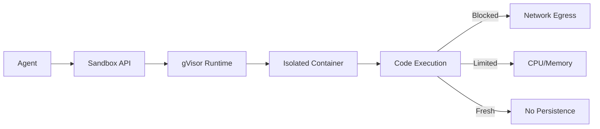

# Secure Agent Code Execution Sandbox

**Live demo:** (static attack-test dashboard, coming soon)

Isolation layer for AI agents to run Python/Bash without compromising the host. Proven through automated attack testing.

## Architecture

## Attack Test Results
(Results from attack suite will be added here with evidence links)

## Performance
| Metric | Measurement | Evidence |
|--------|-------------|----------|
| Sandbox startup | (TBD) | |
| Execution overhead | (TBD) | |
| Memory footprint | (TBD) | |

## Decisions (ADRs)
(Links to docs/adr/*.md will be added here)

## Security
(Link to docs/threat-model.md will be added here)

## Limitations and failure modes
- gVisor is not a silver bullet - host kernel exploits still possible
- Resource limits are enforced but can still be exhausted
- No protection against prompt injection at application layer
- Demo is static dashboard, not live execution endpoint

## Operations
(Link to docs/ops.md will be added here)

## KEAL gates passed
(Link to docs/keal-gates.md will be added here)

## Run it
(Development instructions will be added as project progresses)
